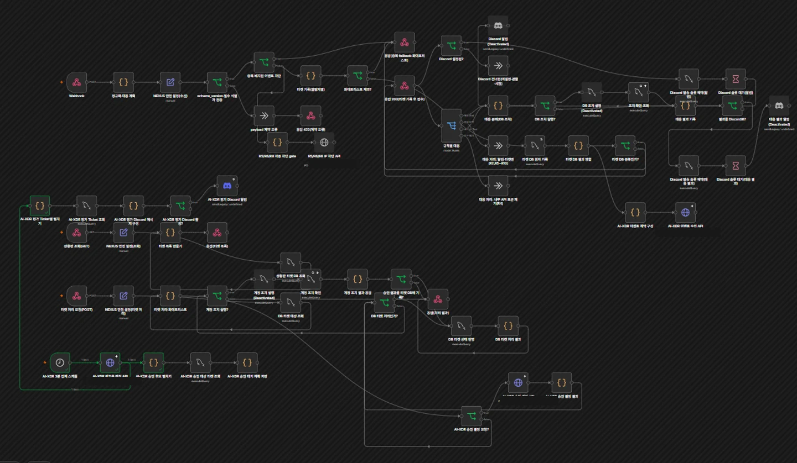

# NEXUS WORK

**NEXUS WORK**는 사내 업무 포털에서 발생하는 보안 이벤트를 수집·탐지하고, 사건 단위 분석과 관리자 대응으로 연결한 4인 팀 보안관제 프로젝트입니다. 최종 시연 환경에서 Graylog R1–R12 규칙과 Published n8n workflow를 운영하며 로그 수집부터 AI-XDR 평가와 대응 검토까지의 흐름을 구축했습니다.

  

워크플로 전체 화면을 클릭하면 프로젝트 웹 포트폴리오로 이동합니다.

  <a href="https://nexus-work-portfolio-site.vercel.app"><strong>웹 포트폴리오</strong></a>
  &nbsp;·&nbsp;
  <a href="https://app.notion.com/p/v3-413d401b317c813b90ded756a4458810?pvs=12">Notion 프로젝트 기록</a>
  &nbsp;·&nbsp;
  <a href="docs/portfolio/README.md">기술 문서</a>

  
  
  
  
  
  
  
  
  

## 프로젝트 소개

로그인, 권한 거부, AI Agent Tool 호출, 웹 요청은 각기 다른 로그로 남습니다. NEXUS WORK는 이 신호를 중앙 탐지와 자동화 흐름에 연결해 관련 경보를 Ticket으로 모으고, AI-XDR 평가와 관리자 판단을 한 흐름에서 확인하도록 만들었습니다.

## 주요 구현

- Flask·MySQL 기반 사내 업무 포털과 역할별 기능
- 포털 보안 이벤트 생성 및 Wazuh 호스트 로그 전달 경로
- Graylog Stream과 R1–R12 Event Definition 기반 탐지
- n8n Webhook을 통한 경보 정규화, Ticket 생성·병합, AI-XDR 전달
- AI-XDR의 verdict·위험 점수·신뢰도·근거·권고 조치와 정책 평가
- 관리자 검토·승인, 대응 기록, Incident 조회·종결

## 시스템 아키텍처

~~~mermaid
flowchart LR
  APP[Flask 포털 이벤트] --> G[Graylog R1–R12 탐지]
  HOST[호스트 보안 로그] --> W[Wazuh 수집·전달]
  W --> G
  G -->|Event / Alert| N[n8n Published workflow]
  N --> T[(Ticket)]
  N -->|events / ready window| X[AI-XDR 평가·정책]
  X --> A[(Assessment)]
  T --> I[Incident 조회·종결]
  A --> I
  X --> M[관리자 검토·승인]
  M --> R[대응 결과 기록]
~~~

## 기술 스택과 담당

| 영역 | 기술과 역할 |
|---|---|
| 포털·데이터 | Flask, Python, MySQL |
| 로그·탐지 | Wazuh 호스트 로그 수집 경로, Graylog Input·Stream·Event Definition |
| 자동화 | n8n Webhook, Ticket 처리, AI-XDR API 연동 |
| 분석·대응 | Groq·NVIDIA·Ollama provider fallback, AI-XDR 정책과 관리자 승인 |
| 팀 구성 | 4인 팀 프로젝트. 김태빈의 개인 담당과 구현 근거는 [기여 문서](docs/portfolio/01-project-and-contribution.md)에 정리 |

## 보안 이벤트 처리

1. 포털은 인증·인가·AI Tool 동작을 구조화된 보안 이벤트로 기록하고, Wazuh는 지정된 호스트 로그를 수집해 Graylog로 전달합니다.
2. Graylog는 Stream과 R1–R12 탐지 규칙으로 이벤트를 분류하고 경보를 생성합니다.
3. Published n8n workflow는 이벤트 필드를 정리하고 새 Ticket을 만들거나 관련 Ticket에 연결합니다.
4. 준비된 이벤트 묶음은 AI-XDR 평가로 전달되어 판정과 대응 정책이 저장됩니다.
5. 관리자는 평가를 검토하고 승인된 대응을 처리합니다. Incident 화면은 사건과 이력을 조회하고 종결합니다.

## 주요 기술적 문제 해결

AI-XDR 분석이 늦어지며 n8n 후속 처리가 504로 끝나는 문제를 추적했습니다. 실행 기록 비교로 집계 주기 변경만이 원인이 아님을 확인했고, 앞단 요청 대기 제한과 provider별 추론 시간을 분리해 살폈습니다. 대기 제한을 90초로 늘려 조기 종료를 완화하고, AI-XDR provider는 Groq 우선의 auto fallback(Groq → NVIDIA → Ollama)으로 운용했습니다. 재현 과정과 조치는 [문제 해결 문서](docs/portfolio/06-validation-and-troubleshooting.md)에 정리했습니다.

## 기술 문서

- [프로젝트 배경과 김태빈의 기여](docs/portfolio/01-project-and-contribution.md)
- [아키텍처와 로그 흐름](docs/portfolio/02-architecture-and-logs.md)
- [Graylog R1–R12 탐지 규칙](docs/portfolio/03-detection-catalog.md)
- [n8n 자동화와 AI-XDR](docs/portfolio/04-automation-and-ai-xdr.md)
- [Incident 데이터와 대응 이력](docs/portfolio/05-incident-and-response.md)
- [검증 결과와 트러블슈팅](docs/portfolio/06-validation-and-troubleshooting.md)
- [로컬 실행·재현 및 한계](docs/portfolio/07-reproduction-and-limitations.md)

## 로컬 실행

다음은 포털과 격리된 로컬 MySQL을 시작하는 개발용 절차입니다. Graylog, n8n, Wazuh, Suricata, pfSense는 별도 환경에서 구성합니다.

~~~powershell
Copy-Item .env.example .env
# .env에서 로컬 전용 비밀값을 설정하고 DB_PORT를 3308로 지정
docker compose -f docker-compose.local.yml up -d
python -m venv .venv
.venv\Scripts\Activate.ps1
pip install -r requirements.txt
python run.py
~~~

포털 주소는 기본값으로 http://127.0.0.1:5070이며, 격리 MySQL은 호스트의 127.0.0.1:3308에서 접근합니다. 실행 변수, Graylog·n8n 재현 절차와 외부 시스템 준비사항은 [실행·재현 문서](docs/portfolio/07-reproduction-and-limitations.md)를 참고하세요.

## 구현 범위

최종 시연 환경은 Graylog R1–R12와 Published n8n workflow를 사용했습니다. AI-XDR은 auto provider 설정으로 Groq를 우선 시도하고, 조건에 따라 NVIDIA와 Ollama를 fallback으로 사용할 수 있습니다. 호스트 로그 수집과 포털 자체 이벤트 생성은 서로 다른 경로이며, pfSense의 실제 네트워크 차단은 별도 장비 설정과 연동됩니다.
