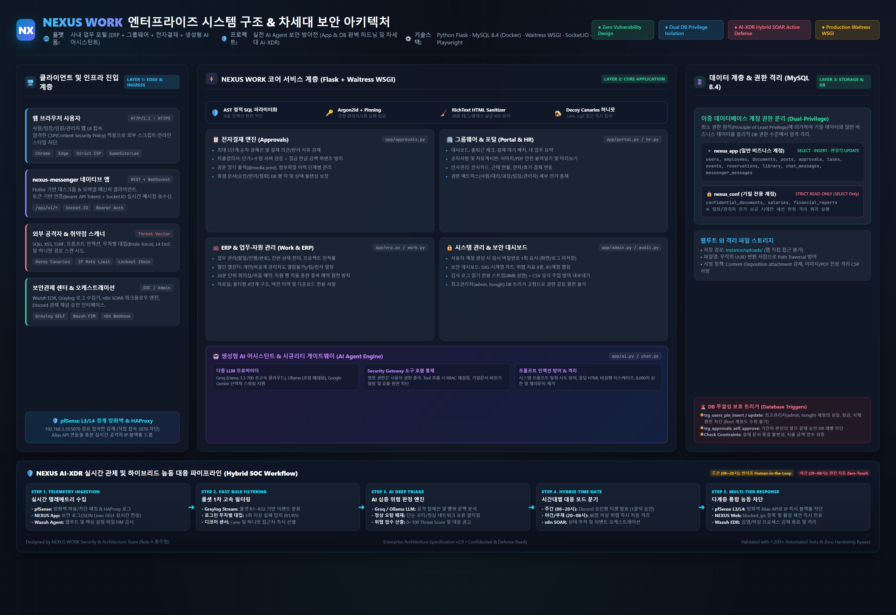

# NEXUS WORK

가상 회사의 사내 업무 포털(그룹웨어 + ERP + AI 챗봇)입니다. 팀 프로젝트 "사내 AI Agent 보안 방어전" 중 **역할 A(앱·DB 하드닝)** 가 만든 웹 앱과 DB입니다. Flask와 MySQL로 만들었고, 모든 입력·권한·세션·업로드·DB 접근을 방어하는 데 초점을 두었습니다.

> 실습용 가상 데이터입니다. 계정·급여·문서는 모두 시험용이며 실제 비밀번호나 개인정보를 넣지 마세요. 방어 점검 스크립트는 내 PC(루프백)의 앱에만 사용하세요.

## 기능

| 구분 | 기능 |
|---|---|
| 홈(첫 화면) | 로그인 후 대시보드: 인사·날짜, 오늘 출퇴근(홈에서 바로 출근·퇴근), 요약 수치(내가 결재할 문서·진행 중인 내 기안·내 업무·남은 연차), 바로 가기, 내가 결재할 문서·내 업무(지연·오늘 마감 표시)·이번 주 일정·내가 올린 결재·공지사항·내 예약, 관리자에게만 관리 칸. 모두 본인 권한 범위 |
| 그룹웨어 | 로그인·로그아웃, 문서함(일반/기밀), 공지사항·자유게시판(첨부 업로드, 그림·PDF 붙여넣기와 글 화면 미리보기), 전자결재, 비밀번호 변경, 프로필 사진(올리기·바꾸기·지우기, 상단바 아바타) |
| ERP | 급여(본인·팀·전체 범위), 경비 등록·상신, 재무 보고(기밀) |
| 업무 | 업무 관리(할 일: 담당자·마감·우선순위·상태 전이·댓글·요청한 업무·팀 업무), 일정(월간 달력, 공개 범위 나만·팀·전사, 참석자, 승인된 휴가와 내 업무 마감 표시), 회의실·비품 예약(30분 단위, 겹침 차단), 프로젝트(구성원·업무·진척률) |
| 자료 | 자료실(폴더형, 전사·부서 공개, 파일 버전 이력, 형식·개수·용량 제한 없음), 주소록(사내 직원·공유 연락처·내 연락처), 문서 검색(문서함·게시판·결재·자료실·양식·업무·연락처를 권한 범위 안에서 한 번에), 양식 서식 모음(관리자 서식 파일 + 전자결재 양식 바로가기) |
| 인사(HR) | 인사카드(사번·입사일·근속·연차), 조직도, 근태관리(출퇴근·지각 표시), 휴가관리(연차·반차·병가 신청, 팀장·관리자 승인·반려, 취소) |
| 전자결재 | 공문 양식 화면(기관명·문서번호·결재란·제목·시행일자·기안·수신·참조·본문·붙임·끝·발신 명의, 인쇄 가능)과 서식 편집기(글자 크기·색·배경·정렬·제목·목록, 표 삽입·행/열 추가·칸 합치기), 양식 5종(일반 기안·업무 협조·출장 신청·구매 요청·**지출결의서**)과 문서번호, 긴급 표시, 상신자가 정하는 순차 결재선(최대 5명), 참조자, 첨부(상신할 때와 결재자가 승인·반려할 때, 개수·형식·용량 제한 없음, 단계별로 구분 표시), 승인 의견·반려 사유, 상신 철회, 재기안, 문서함(기안함·결재 대기·결재 예정·처리 완료·참조함)과 메뉴의 결재 대기 건수, 결재란 화면 |
| AI 어시스턴트 | 대화 화면과 본인 대화 기록, 파일 첨부(txt·md·csv·json·log·pdf·docx 글자를 그 질문에만 참고). 사용자 권한 범위의 사내 자료로 답한다. 제공자는 Groq(기본, `.env AI_PROVIDER`)·로컬 Ollama·Gemini·내장이고 화면에서 바꿀 수 있다 |
| 관리(시스템 관리) | 관리 현황(사용자·잠금·결재·휴가·출근·최근 보안 이벤트), 사용자 관리(등록(부서는 목록 선택)·**부서**·역할·**직급** 변경·비밀번호 초기화·잠금·잠금 해제, **최고관리자(admin·hongjh) 고정**, **사용자 삭제(최고관리자만, 기록 보존)**), **보안 대시보드**(요약 지표·시간/일별 추이 그래프·위협 지표·상위 IP/계정/의심 입력·잠긴 계정·필터·상세·CSV 내보내기, 보안관제팀·시스템관리자 전용), 권한 현황(직급별·팀별·역할별 권한표와 고정 계정) |
| 보안 로그 | 모든 보안 이벤트를 JSON 한 줄로 `logs/security.jsonl`에 기록(탐지 담당이 수집) |
| 메신저 연동 | 별도 네이티브 앱(nexus-messenger)이 토큰으로 로그인해 1:1·그룹 채팅하는 `/api/v1/*` API + Socket.IO 실시간 전송. 자세히는 [docs/02_메신저_API.md](docs/02_메신저_API.md) |

## 보안 설계 요약

| 영역 | 적용 |
|---|---|
| 쿼리 | 모든 SQL은 상수 문자열 + 파라미터 바인딩(AST 정적 검사가 강제) |
| 인증 | Argon2id, 5회 실패 15분 잠금, 동일한 실패 메시지(계정 열거 방지), 로그인 IP 속도 제한, 세션 재발급 |
| 세션 | HttpOnly·SameSite=Lax, 유휴 30분·절대 8시간, 로그아웃·비밀번호 변경 시 이전 쿠키 전부 무효화 |
| 인가 | 서버에서 역할·소유자·팀 범위 검사, 사용자·역할·잠금은 요청마다 DB 재조회, `/admin/*` 블루프린트 단위 보호 |
| 출력 | 자동 이스케이프(끄지 않음), CSP(인라인 스크립트·스타일 불가), nosniff, X-Frame-Options |
| 업로드 | **게시판·결재 첨부는 형식·개수·용량 제한이 없다**(2026-10-19 사용자 결정). 대신 무해하게 다룬다: 무작위 파일명으로 웹루트 밖에 조각 단위로 저장(메모리에 통째로 올리지 않음), 이름은 안전한 문자만, 형식은 거부하지 않고 분류만(그림·PDF는 내용이 맞을 때만 인정, 나머지는 일반 바이너리), 읽을 수 없는 파일(백신 격리 등)은 404. 프로필 사진만 png·jpg + 내용 확인과 2MB 상한이 그대로다. 다운로드는 항상 첨부로, 그림(png·jpg)·PDF만 별도 미리보기 경로(`/attachments/<id>/view`)로 인라인 표시(경로 전용 CSP `default-src 'none'`, nosniff, 로그인 필요) |
| DB 권한 | 일반 표는 `nexus_app`(필요한 열만 UPDATE), 기밀 표(기밀 문서·급여·재무)는 `nexus_conf`(읽기 전용) |
| 결재 | 순차 결재·종결 상태 불변·자기 승인 금지(앱 + DB 트리거), 결재선 열은 앱 계정이 수정 불가 |
| 로그 | 표준 필드의 JSON, 비밀번호·대화 내용 미기록, 의심 입력(`suspicious_input`)은 차단 없이 기록 |

## 아키텍처 및 시스템 구조



- **상세 아키텍처 이미지:** [NEXUS_WORK_시스템_아키텍처_구조도.png](NEXUS_WORK_시스템_아키텍처_구조도.png) / [docs/NEXUS_WORK_시스템_아키텍처_구조도.png](docs/NEXUS_WORK_시스템_아키텍처_구조도.png)
- **대화형 아키텍처 웹문서:** [docs/NEXUS_WORK_시스템_아키텍처_구조도.html](docs/NEXUS_WORK_시스템_아키텍처_구조도.html)
- **차세대 AI-XDR 기획서:** [docs/NEXUS_AI-XDR_하이브리드_관제_기획안.md](docs/NEXUS_AI-XDR_하이브리드_관제_기획안.md)

자세한 설계는 [docs/01_기획.md](docs/01_기획.md) 및 [docs/03_팀_연동안내.md](docs/03_팀_연동안내.md)에 있습니다.

## 설치와 실행

필요한 것: Python 3, Docker Desktop. (개발과 시험은 Python 3.14, Windows 11에서 했고 다른 버전·OS는 확인하지 않았습니다.)

```bash
# 1) 환경 파일 만들기 — .env 는 Git 에 올라가지 않습니다
cp .env.example .env
#    .env 를 열어 MYSQL_ROOT_PASSWORD, NEXUS_APP_PASSWORD, NEXUS_CONF_PASSWORD, SECRET_KEY 를 임의의 긴 값으로 바꿉니다.
#    예: python -c "import secrets; print(secrets.token_urlsafe(32))"
#    LAB_INTERNAL_API_TOKEN(기밀 문서에 들어가는 실습용 토큰)은 팀 채팅으로 받은 값을 넣습니다(만드는 법은 .env.example).

# 2) MySQL 컨테이너 (호스트 127.0.0.1:3307, 최초 1회 스키마·계정이 자동 생성됩니다)
docker compose up -d

# 3) 파이썬 환경
python -m venv .venv
.venv\Scripts\activate          # macOS/Linux: source .venv/bin/activate
pip install -r requirements.txt

# 4) 시험 데이터 넣기(계정 6개, 문서·급여·경비·결재)
python scripts/seed.py --db nexus

# 5) 실행 — 기본은 http://127.0.0.1:5070 (내 PC만)
python run.py
```

기본 포트가 다르거나 PC의 다른 MySQL과 겹치면 `.env`의 `DB_PORT`를 바꿉니다(컨테이너 내부 포트는 3306 그대로입니다).

다른 장비(네트워크 담당 장비·Kali)에서 접속하게 하려면 `.env`의 `APP_HOST`를 `0.0.0.0`으로 바꿔 실행합니다(포트는 `APP_PORT`, 기본 5070). 이 PC의 주소, 방화벽, 확인 방법은 [docs/03_팀_연동안내.md](docs/03_팀_연동안내.md)에 있습니다.

### 시험 계정

| 아이디 | 역할 | 부서 |
|---|---|---|
| kim, han | 직원 | 영업팀 |
| park | 직원 | 개발팀 |
| lee | 팀장 | 영업팀 |
| choi | 팀장 | 개발팀 |
| admin | 관리자 | 경영지원팀 |

비밀번호는 `.env`의 `SEED_KIM_PW`(kim·han·park), `SEED_LEE_PW`(lee·choi), `SEED_ADMIN_PW`(admin)입니다. 기본값은 `.env.example`에 있는 시험용 값이며, 공유 환경에서는 바꾸세요(외부 주소로 띄울 때 예시 값 그대로면 `run.py`가 경고합니다).

기밀 문서(팀장·관리자만 열람)에는 시나리오용 식별 문구(`NXC-…`)가 들어 있고, `M&A_PLAN`에는 실습용 내부 API 토큰도 들어 있습니다. 자세한 내용은 [docs/03_팀_연동안내.md](docs/03_팀_연동안내.md) 2절에 있습니다.

## 테스트와 점검

```bash
python -m pytest -q                                   # 전체 자동 시험(1202개, MySQL 컨테이너 필요)
python scripts/defense_check.py --report 결과.md      # 방어 점검 18항목(서버를 띄운 상태에서, 루프백만 허용)
python scripts/red_team_extra.py --report 결과2.md    # 추가 공격 패턴 20항목(같은 전제, SSTI·동시성 경쟁 등)
```

- 자동 시험은 DB 권한, 입력 검증, 인증·세션, 인가, 업로드, 결재 규칙, 화면 접근성과 색 대비, 정적 점검(위험 패턴·공개 경로·비밀값)을 다룹니다. MySQL이 없으면 DB가 필요한 시험은 건너뜁니다.
- 사람이 직접 확인하는 절차는 [docs/검증안내서.md](docs/검증안내서.md), 시나리오·로그·탐지 연계는 [docs/실측_검증계획_A.md](docs/실측_검증계획_A.md)에 있습니다.

## 폴더 구조

```
app/            Flask 앱 (auth, portal, erp, hr, profile, audit, richtext(결재 본문 살균기), approvals, admin, chat, messenger_api, realtime, security, db, validators, uploads)
  templates/    화면    static/  스타일(CSP 때문에 외부 글꼴·인라인 스타일 없음)
db/             schema.sql, grants.sql(최소권한), init.sh(컨테이너 최초 기동 때 실행)
scripts/        seed.py(시험 데이터), migrate_hr.py·migrate_approval.py·migrate_work.py·migrate_security.py(이미 있는 DB 에 인사·전자결재·업무·자료 확장과 권한 고정·직급 권한 추가), create_team_admins.py, defense_check.py·red_team_extra.py(방어 점검)
tests/          pytest 시험
docs/           설계·검증·트러블슈팅·메신저 API·팀 연동 안내 문서
run.py          개발·시연용 실행(서버 버전 비노출, 기본 루프백 — .env 의 APP_HOST 로 변경, Socket.IO 포함)
```

## 다른 담당과 맞닿는 곳

다른 담당에게 넘겨주는 내용(포털 주소·포트, 시나리오 데이터, 이후 DB 대응 열·n8n 계정 등)은 [docs/03_팀_연동안내.md](docs/03_팀_연동안내.md)에 모아 둡니다.

- **탐지(Wazuh·Graylog):** `logs/security.jsonl`의 이벤트와 필드는 [실측_검증계획_A.md 4절](docs/실측_검증계획_A.md)에 정리되어 있습니다.
- **AI·Gateway:** `app.config["CHAT_RESPONDER"]`를 `responder(user, message, history) -> str`로 교체해 연결합니다. 챗봇의 권한은 현재 로그인한 사용자를 넘을 수 없습니다([app/chat.py](app/chat.py) 머리말).
- **Gateway:** 기밀 표는 `nexus_conf` 계정(읽기 전용)으로만 읽습니다.
- **자동 대응(n8n):** 앱은 사용자·역할·잠금을 요청마다 DB에서 다시 읽으므로 `users.locked_until`·`role`·`session_version`을 바꾸면 즉시 반영됩니다([실측_검증계획_A.md 5절](docs/실측_검증계획_A.md)).
- **메신저(nexus-messenger, 별도 Flutter 프로젝트):** 토큰 인증 `/api/v1/*` + Socket.IO. 전체 스펙은 [docs/02_메신저_API.md](docs/02_메신저_API.md).

## 알려진 한계

직접 만든 대표 탐침으로 점검했고(블랙박스 도구로도 추가 확인함 — nmap·nikto·gobuster·sqlmap·hydra, 전부 이상 없음) 의존성 취약점 점검은 하지 않았습니다. HTTPS(Secure 쿠키)·부하·로그 원격 전송은 검증하지 않았고, 속도 제한은 서버 프로세스 메모리 기반이라 **여러 실제 IP를 가진 공격자에게는 IP별로 따로 적용됩니다**(IP 기반 속도 제한의 일반적 한계). 자세한 내용은 [실측_검증계획_A.md 6절](docs/실측_검증계획_A.md)을 보세요.

## 문서

[docs/01_기획.md](docs/01_기획.md) · [docs/02_메신저_API.md](docs/02_메신저_API.md) · [docs/03_팀_연동안내.md](docs/03_팀_연동안내.md) · [docs/NEXUS_AI-XDR_하이브리드_관제_기획안.md](docs/NEXUS_AI-XDR_하이브리드_관제_기획안.md) · [docs/04_보안_AI_최종_도입가이드.md](docs/04_보안_AI_최종_도입가이드.md) · [docs/검증안내서.md](docs/검증안내서.md) · [docs/실측_검증계획_A.md](docs/실측_검증계획_A.md) · [docs/검증결과_A_2026-10-17.md](docs/검증결과_A_2026-10-17.md) · [docs/트러블슈팅.md](docs/트러블슈팅.md) · [VULN-FINDINGS.md](VULN-FINDINGS.md) · [작업내역_체크리스트.md](작업내역_체크리스트.md)
