# 🛡️ [NEXUS WORK] 차세대 보안 AI 도입 및 전주기 방어 전략 제안서

**문서 번호:** NX-SEC-2026-PROP  
**수신:** NEXUS WORK 개발 및 보안 관제 팀원 일동  
**주제:** 엔비디아(NVIDIA) 고성능 AI 모델 및 Cloudflare 보안 감사 스킬 기반의 공방 방어 체계 구축

---

## 1. 추진 배경 및 개요

`nexus-work`는 가상 회사의 사내 업무 포털(그룹웨어 + ERP + AI 챗봇)로서, **"사내 AI Agent 보안 방어전"**을 위한 견고한 웹/DB 하드닝과 자체 보안 로그(`logs/security.jsonl`), 규칙 기반 XDR(`app/ai_xdr.py`) 체계를 운영 중입니다.

본 제안은 **로컬 인프라(Ollama 등)의 리소스 한계를 극복**하고, **최신 글로벌 보안 AI 생태계(NVIDIA & Cloudflare)**를 결합하여 개발 단계(사전 코드 감사)부터 배포 후 운영(실시간 관제 및 AI 챗봇 보호)까지 **전주기(Lifecycle) 보안 파이프라인**을 완성하는 것을 목표로 합니다.

---

## 2. 보안 AI 역할 분담 및 핵심 구성

보안 AI는 성격과 동작 계층에 따라 크게 세 축으로 역할을 분담합니다.

```mermaid
flowchart TD
    subgraph PreDeploy["1단계: 배포 전 소스코드 보안 감사 (Red Team)"]
        A["Cloudflare security-audit-skill"] -->|6단계 적대적 검증| B["잠재 취약점 발굴 (VULN-FINDINGS) & 사전 패치"]
    end

    subgraph RuntimePortal["2단계: 사내 AI 어시스턴트 입출력 방어 (In/Out Guard)"]
        User["사용자 질의"] --> Guard["NVIDIA NeMo Guardrails / Prompt-Guard"]
        Guard -->|인젝션 차단 / 사내 규정 준수| C["app/ai.py (RAG Gateway)"]
        C --> OutFilter["기밀 데이터 마스킹 & Llama Guard"]
        OutFilter --> Resp["안전한 응답 반환"]
    end

    subgraph RuntimeXDR["3단계: 실시간 런타임 보안 관제 (Blue Team XDR)"]
        Logs["logs/security.jsonl"] --> XDR["app/ai_xdr.py (메타데이터 Triage)"]
        XDR --> NIM["NVIDIA Llama-3.1-Nemotron-70B-Instruct (NIM API)"]
        NIM -->|심층 침해 추론| Decision["최종 판정 (MALICIOUS) & 자동 IP 차단"]
    end
```



---

## 3. 핵심 도구별 세부 역할 및 도입 방안

### ① Cloudflare `security-audit-skill` (사전 코드 취약점 전수 검사)

* **역할:** 소스코드를 해커(Red Team) 관점에서 6단계로 정밀 검증하는 **AI 코딩 에이전트 전용 보안 감사 스킬**
* **차별점:** 기존 정적 분석기나 단순 LLM의 치명적 단점인 **"가짜 취약점(False Positive, 환각)"**을 배제하기 위해, 발견된 후보 취약점을 독립된 서브에이전트가 반박(Disprove)하는 검증 절차를 거칩니다.
* **적용 포인트:**
  * `nexus-work`의 첨부파일 무제한 업로드 정책에 따른 잠재적 파일 취약점(RCE, Path Traversal) 점검
  * ERP 급여, 기밀 문서(`nexus_conf`), 전자결재 순차 결재선에 대한 인가 결함(BOLA/IDOR) 탐지
  * `VULN-FINDINGS.md` 및 `.json`을 최신화하고 방어 하드닝 패치 도출

---

### ② NVIDIA Llama-3.1-Nemotron-70B-Instruct (실시간 XDR 보안 관제)

* **역할:** `app/ai_xdr.py`의 핵심 분석 엔진 (로컬 Ollama를 대체하는 70B급 엔터프라이즈 추론 모델)
* **선정 이유:**
  1. **로컬 부하 0:** 엔비디아 클라우드 NIM 인프라를 활용하여 서버 CPU/RAM 부담 없이 동작.
  2. **심층 공격 체인(Attack Chain) 추론:** 단편적인 로그 나열이 아닌, 연속된 이벤트(예: R1 무차별 대입 실패 후 R5 관리자 권한 접근)를 연계하여 복합 공격 시나리오를 식별.
  3. **코드 호환성:** 기존 OpenAI 규격(`v1/chat/completions`)과 100% 동일하여 `app/ai_xdr.py`에 즉시 적용 가능.
* **설정 방법 (`.env`):**
  ```ini
  XDR_AI_PROVIDER=nvidia
  NVIDIA_API_KEY=nvapi-xxxxxxxxxxxxxxxxxxxxxxxx
  NVIDIA_MODEL=nvidia/llama-3.1-nemotron-70b-instruct
  NVIDIA_BASE_URL=https://integrate.api.nvidia.com/v1
  ```

---

### ③ NVIDIA NeMo Guardrails & Prompt Guard (AI 어시스턴트 보호)

* **역할:** `app/ai.py`의 사내 RAG 챗봇을 타깃으로 하는 프롬프트 인젝션(탈옥) 및 권한 탈취 차단
* **주요 기능:**
  * **사내 규정 준수 (Colang 기반 정책):** 직급 및 권한을 벗어난 기밀 열람 요구, 시스템 프롬프트 무력화 공격을 LLM 전달 전에 선제 차단.
  * **기밀 데이터 유출 방지:** 응답 텍스트 내 사내 토큰(`nxapi_...`)이나 기밀 식별자(`NXC-...`) 노출을 2차 검증.

---

## 4. 기존 체계 vs 도입 후 개선 효과

| 항목 | 기존 (Ollama / 휴리스틱 룰) | 도입 후 (NVIDIA Nemotron + Cloudflare) |
|---|---|---|
| **코드 취약점 감사** | 수동 점검 및 단발성 테스트 | **Cloudflare 6단계 적대적 자동 감사로 오탐 제로화** |
| **관제 분석 모델** | 로컬 Ollama (7B 경량 모델) | **엔비디아 70B급 Nemotron-Instruct (초고성능 추론)** |
| **서버 자원 소모** | 로컬 GPU/RAM 점유율 높음 | **NIM API 기반으로 로컬 리소스 소모 0** |
| **위협 판정 정확도** | 단일 룰 매칭 위주 (오탐/미탐 존재) | **다단계 공격 체인 종합 분석 및 정밀한 IP 차단 근거 제시** |
| **AI 챗봇 방어** | 정규식/문자열 기반 인젝션 방어 | **NVIDIA NeMo Guardrails 기반의 의미론적 정책 강제** |

---

## 5. 팀 단계별 실행 로드맵 (Action Items)

> [!IMPORTANT]
> 작업 순서는 코드베이스 안전성을 확보하는 **사전 감사** 후, 실시간 운영 계층인 **XDR과 어시스턴트** 순으로 진행합니다.

1. **[1단계: 코드 전수 감사]**
   * Cloudflare `security-audit-skill`을 에이전트에 로드하여 `nexus-work` 전체 소스코드 취약점 스캔 실행
   * 도출된 취약점 리포트를 바탕으로 `VULN-FINDINGS.md` 갱신 및 취약점 1차 조치
2. **[2단계: XDR 엔진 전환]**
   * [build.nvidia.com](https://build.nvidia.com)에서 NVIDIA NIM API Key 발급
   * `app/ai_xdr.py`의 LLM 호출부에 엔비디아 엔드포인트 연동 (`.env` 반영)
   * 모의 공격 로그를 주입하여 `VERDICTS` (MALICIOUS) 및 IP 차단 명령 정상 동작 테스트
3. **[3단계: AI 어시스턴트 가드레일 강화]**
   * `app/ai.py` 앞단에 인젝션 탐지 및 정책 검증 레이어 안착
