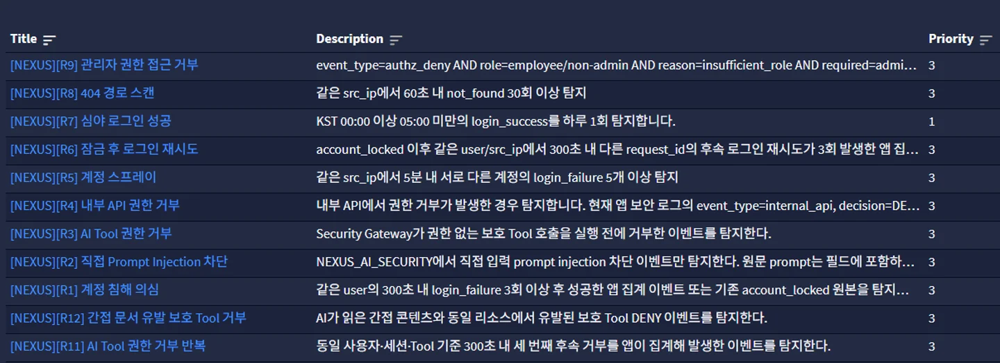
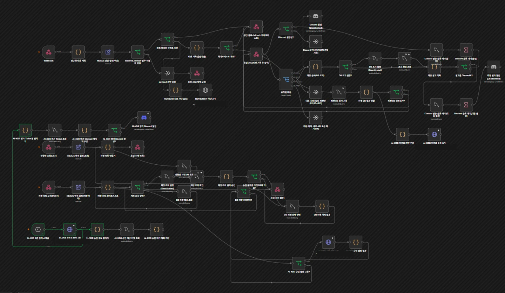

# 아키텍처와 보안 로그 흐름

## 전체 데이터 흐름

~~~mermaid
flowchart LR
  subgraph Sources[이벤트 출처]
    APP[NEXUS 포털 애플리케이션 보안 이벤트]
    HOST[서버·호스트 보안 로그]
    OTHER[환경별 연동 로그]
  end
  W[Wazuh 호스트 수집 경로]
  G[Graylog Input·Stream·Event Definition]
  N[n8n Webhook·Ticket 처리]
  T[(Ticket 저장소)]
  X[AI-XDR API]
  XD[(AI-XDR DB)]
  I[Incident 화면]
  M[관리자 검토·승인]
  F[blocked IP feed]
  P[pfSense 별도 Alias·Firewall 설정]

  APP --> G
  HOST --> W --> G
  OTHER --> G
  G -->|Event/Alert| N
  N --> T
  N -->|events| X --> XD
  N -->|ready window process| X
  T --> I
  XD --> I
  X --> M
  M --> T
  X -. 조건부 feed .-> F
  F -. 실제 연결 검증 별도 .-> P
~~~

이 도식은 역할을 설명하는 개념도입니다. 실제 주소, 방화벽 경로, 운영 장비의 현재 연결 상태를 표시하지 않습니다.

## 구성요소 경계

| 구성요소 | 흐름에서 맡는 일 | 저장소에서 확인한 범위 |
|---|---|---|
| Flask 포털 | 업무 기능, AI Assistant, 애플리케이션 보안 이벤트 생성, 내부 AI-XDR API/UI | 현재 코드 확인 |
| MySQL | 포털 데이터, Ticket 또는 AI-XDR 이벤트·평가 저장 | schema와 Compose 확인. 환경에 따라 DB가 분리될 수 있음 |
| Wazuh | Agent/Manager 구성으로 호스트 로그를 수집·전달 | 설정 템플릿과 적용 안내 확인. 전체 R1–R12 이벤트의 생성자는 아님 |
| Graylog | 로그 검색·Stream 분류·Event Definition 평가 | 여러 시점의 export와 importer 확인. 최종 운영 12 Rule은 참여자 제공 사실 |
| n8n | Graylog 알림 수신, 이벤트 필드 정리, Ticket 연결, API 호출 | 재현용 template과 실행 기록이 존재. 최종 Published 상태는 참여자 제공 사실 |
| AI-XDR | 이벤트 window 조회, 모델 평가, policy 판단, assessment와 response 결과 저장 | Flask 코드·schema·테스트 확인 |
| Incident UI | Ticket, 평가, 대응 이력 조회와 종결 | 현재 코드에서 Ticket API와 로컬 자료를 병합/fallback |
| Suricata | 네트워크 탐지 로그 출처로 프로젝트 자료에서 언급 | 이 저장소에서 실제 설정·실행 상태는 확인되지 않음 |
| pfSense | feed/alias/firewall rule이 연결되면 네트워크 정책 적용 | 앱의 blocked IP API/feed 코드는 있음. 실제 장비 설정·차단 증거는 미확인 |

## 이벤트를 누가 만드는가

NEXUS 포털은 로그인, 권한 거부, AI Tool 실행 등 애플리케이션 내부에서 발생한 이벤트를 공통 logger로 구조화할 수 있습니다. 핵심 경로는 app/security.py의 log_event()입니다. 이벤트는 정해진 필드만 기록하며, 설정에 따라 JSONL 또는 GELF로 전달됩니다.

Wazuh는 Agent가 수집할 호스트 로그 경로를 담당합니다. 앱에서 발생한 agent_tool_call이나 authz_deny는 포털이 만드는 이벤트입니다. 따라서 “Wazuh가 R1–R12를 전부 탐지한다”는 설명은 맞지 않습니다.

Graylog는 이 원본 로그를 받아 다음 단계를 수행합니다.

1. Input에서 원본 수신
2. Stream 및 field 조건에 따라 분류
3. Event Definition의 검색·집계 조건 평가
4. 조건을 만족하면 Event/Alert 생성
5. 설정된 Notification을 통해 n8n 등으로 전달

원본 메시지가 검색된다는 사실, Graylog Event가 생성됐다는 사실, Notification이 전달됐다는 사실은 각각 따로 확인해야 합니다.

*Graylog 설정 화면의 보관 캡처 일부입니다. 최종 운영 환경의 모든 규칙이나 개별 Event 발생을 증명하는 자료로 사용하지 않습니다.*

*n8n workflow 전체 화면의 보관 캡처입니다. 운영 workflow의 Published 상태 및 특정 execution 성공 여부와는 별도 증거입니다.*

## 네트워크 토폴로지

공개 문서에서는 내부 IP와 포트 대신 논리적 구역만 나타냅니다.

- **앱 구역:** Flask 포털·내부 API·앱 DB
- **관제·자동화 구역:** Graylog·n8n·Wazuh Manager
- **호스트 구역:** Wazuh Agent가 설치된 서버
- **경계 구역:** pfSense 등 외부 네트워크 장비
- **데이터 구역:** Ticket DB와 AI-XDR DB; 동일 DB일 필요는 없음

현재 제공된 코드/설정에는 개발·재현 주소가 남아 있고, 이는 최종 운영망 토폴로지의 권위 있는 자료가 아닙니다. 기존 아키텍처 이미지에도 내부 주소와 과거 구조가 표시되어 있어 이 문서에는 연결하지 않았습니다.

## 이벤트 필드와 개인정보 경계

보안 logger의 공통 필드에는 event_type, source_component, severity, user, role, src_ip, method, path, decision, reason, request_id 등의 메타데이터가 포함될 수 있습니다. 비밀번호, API token, 대화 원문, 첨부 원문은 이벤트에 싣지 않는 방향으로 코드와 allowlist가 구성돼 있습니다.

관련 구현:
- [보안 이벤트와 GELF](../../app/security.py)
- [설정과 기본값](../../app/config.py)
- [앱 초기화](../../app/__init__.py)
- [Wazuh 설정 자료](../../security_migration/export/wazuh/)
- [Graylog 기본 export](../../security_migration/export/graylog/)
