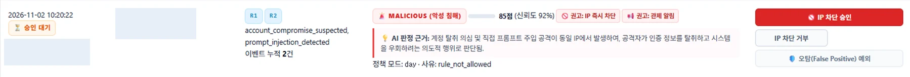

# n8n 자동화와 AI-XDR 평가

## n8n이 잇는 흐름

최종 시연 환경에서 n8n workflow를 Published 상태로 운영했습니다. n8n은 Graylog 경보를 받아 필요한 필드를 정리하고, Ticket을 생성하거나 기존 사건과 연결한 뒤, 처리 가능한 이벤트 묶음을 AI-XDR로 전달합니다.

~~~mermaid
sequenceDiagram
  participant G as Graylog
  participant N as n8n Published workflow
  participant T as Ticket 저장소
  participant X as AI-XDR API
  participant D as AI-XDR DB
  participant A as 관리자 화면

  G->>N: Event / Alert webhook
  N->>N: 필드 정규화·중복 확인
  N->>T: Ticket 생성 또는 병합
  N->>X: events 요청, Ticket ID 전달
  X->>D: 이벤트 저장
  N->>X: process 요청, 준비된 window 처리
  X->>D: 이벤트 조회·assessment 저장
  X-->>N: 처리 결과 반환
  N->>T: Ticket 후처리·대응 이력
  D-->>A: AI-XDR 평가 표시
~~~

n8n은 데이터 전달과 실행 순서를 조율합니다. Verdict·위험 점수·정책 판단은 AI-XDR에서 처리합니다.

*assessment 화면에는 판정, 점수, 권고와 관리자 처리 상태가 함께 표시됩니다.*

## Ticket 묶기와 AI-XDR 처리 시점

첫 경보가 들어오면 Ticket을 만들고, 같은 사건으로 묶이는 후속 경보는 설정된 집계 구간 동안 그 Ticket에 연결합니다. 프로젝트 발표에서 설명한 운영 흐름은 첫 경보부터 3분 동안 같은 사건의 경보를 모은 뒤 AI-XDR 분석으로 넘기는 방식입니다.

n8n의 Schedule 실행 간격은 처리 가능한 window가 닫혔는지 확인하는 주기이며, Ticket 집계 구간과 같은 값이 아닙니다. 따라서 경보가 집계 구간에 들어왔다고 즉시 분석되는 것은 아니며, window가 준비된 다음 process 실행에서 assessment가 만들어집니다.

## Ticket 식별자

| 값 | 용도 |
|---|---|
| numeric id | Ticket DB 내부 PK |
| ticket_key | 같은 IP·사용자 등으로 사건을 묶는 grouping key |
| NX-DB-xxxxxx | 화면 표시와 시스템 간 상관관계에 쓰는 외부 Ticket ID |

n8n과 AI-XDR은 외부 Ticket ID를 events payload의 ticket_ids로 전달합니다. ticket_key와 NX-DB 표시 ID는 서로 다른 목적의 값입니다.

## events와 process

1. n8n은 Graylog Event의 Rule, alert 식별자, src_ip, user, event_type 등의 값을 정규화합니다.
2. AI-XDR events API는 입력을 검증하고 Ticket 식별자와 함께 보안 이벤트를 저장합니다.
3. process API는 준비된 window의 이벤트를 읽고 사건 단위 summary를 구성합니다.
4. 선택된 AI provider가 verdict, threat_score, confidence, reasoning, recommended_actions를 반환합니다.
5. 서버 정책은 결과와 별도로 approval_allowed, auto_allowed, policy_reason 등을 계산하고 assessment를 저장합니다.
6. n8n은 처리 결과와 Ticket 정보를 사용해 후속 기록과 설정된 알림을 진행합니다.

관련 구현: [events/process API](../../app/internal_api.py), [AI-XDR 처리](../../app/ai_xdr.py)

## Provider 선택과 응답 검증

AI-XDR provider는 AI Chat과 분리된 설정을 사용합니다. 최종 시연 환경은 auto 설정이며, Groq를 우선하고 요청 실패나 사용 가능 여부에 따라 NVIDIA, Ollama를 순서대로 fallback합니다. 실행별 provider와 model은 실제 선택 결과에 따라 달라질 수 있습니다.

AI-XDR은 provider 응답을 JSON으로 읽은 뒤 strict schema를 검증합니다. 호출, 파싱 또는 검증에 실패하면 fail-safe REVIEW 결과를 기록해 불완전한 응답을 정상 악성·정상 판정으로 오인하지 않도록 합니다. AI Chat은 별도 provider 설정을 사용합니다.

## 분석 권고와 관리자 대응

AI-XDR의 recommended_actions는 분석 권고입니다. assessment에는 정책 판정과 승인 상태가 함께 기록되고, 관리자는 AI-XDR 화면에서 평가를 확인해 대응을 결정합니다. Incident 화면은 이 평가와 대응 이력을 조회하는 역할을 맡으며 차단 승인 UI를 대신하지 않습니다.

## Discord 후속 알림

assessment와 Ticket 정보를 결합해 Rule, Ticket ID, 출발지, event_type, verdict, threat score, confidence, 권고 조치, assessment ID, 정책·상태, 승인 여부를 메시지로 구성하는 후속 경로를 연결했습니다. 실제 전송은 Discord gate와 workflow 설정이 켜진 경우에만 이뤄집니다.

## 관련 코드와 자료

- [AI-XDR 설정](../../app/config.py)
- [provider fallback·triage·정책](../../app/ai_xdr.py)
- [events/process 및 승인 API](../../app/internal_api.py)
- [Ticket schema](../../db/schema.sql)
- [workflow 화면](assets/workflow.webp)
- [재현용 n8n 패키지 안내](../../repro-package/NEXUS-WORK-REPRO-2026-11-09/n8n/README.md)
